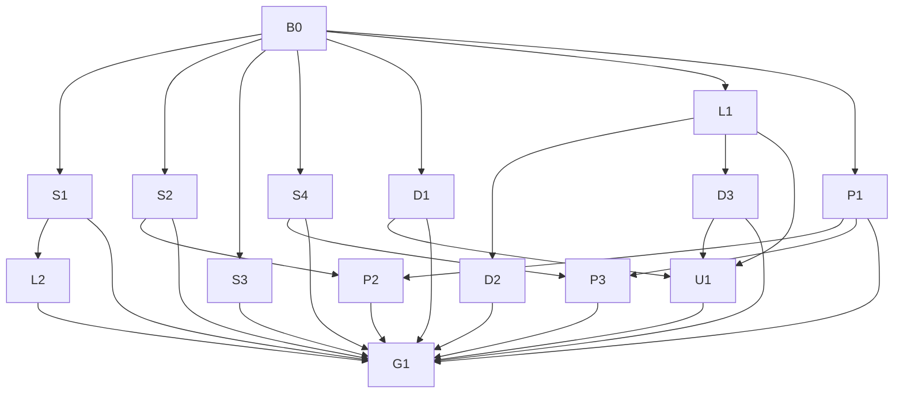

# 11. Dependency-ordered implementation roadmap

**Planning only. No package is implemented by this change.** IDs below own
implementation scope and prerequisites. Domain documents specify detailed
contracts and cases; this roadmap resolves scheduling and exit authority.

Priority: P0 correctness/security/release blockers; P1 required hardening or
evidence; P2 optional improvements selected only after benefit. Complexity is
relative S/M/L, not a duration estimate: S = one bounded seam, M = several
owners/tests, L = native/platform/persistence work with uncertain reproduction.
Every implemented package includes source/sibling audit, regression tests,
truthful docs and automated verification before owner live acceptance.

## Phase and dependency map

| Phase | Packages | Intent |
| --- | --- | --- |
| R34.0 Baseline and capability inventory | B0 | Exact source, packages, native assets, current per-host measurements |
| R34.1 Security hardening | S1-S4 | Process and ingest availability first; secrets and containment |
| R34.2 Authority collapse and deletion | D1-D3 | Remove redundant declarations/boilerplate/workarounds only with equivalent behaviour |
| R34.3 Measured optimisation | P1-P3 | Instrument existing evidence, then retrieval/runtime experiments |
| R34.4 Lifecycle and concurrency | L1-L2 | Reproduce view ownership and verify bounded owned work |
| R34.5 Moss native polish and release acceptance | U1, G1 | Observed native refinement, integration and owner gates |

D2/P2 are optional implementation; their investigation/disposition is still
recorded before G1. Conditional packages can close as a justified Retain/Defer
after their acceptance investigation, without inventing a feature or blocking
mandatory safety repairs. L1 and security/dependency work can overlap after
B0. U1 captures baseline visuals early but final polish waits for relevant
lifecycle/font/tooltip decisions. Phase numbers do not create six waterfalls.

## R34.0

### B0: frozen baseline and capability inventory

- **P0, Composition/Services/Rag/Desktop/packaging; M.** Evidence: [01](01-current-state-and-evidence.md),
  [03](03-dependencies-and-native-assets.md), [07](07-performance-baselines.md).
  Prerequisites: none.
- **Scope:** refresh 13-project/resolved graph for exact implementation HEAD
  and publish RIDs; capture R33 per-host controls, source/asset/runtime hashes,
  build/test/package evidence and native module versions. Inventory existing
  owner settings read-only; use scratch roots for experiments. Establish
  measurement variability and practical regression decision rules before changes.
- **Acceptance:** complete fingerprint/raw-evidence manifest for each available
  target, missing cells Unknown, explicit old/new comparability; no owner data
  in reports. SQLite native identity and licence/notice delivery verified in
  real packages. Freeze security budgets below and investigate native dependency
  skew, not simply remove pins. This planning inventory is useful input, not
  closure of future execution baselines.
- **Automated:** zero-warning solution Debug/Release, full sequential applicable
  suite with honest skips, current dependency audit, existing notice/architecture
  guards; `sqlite_version()` and publish-layout/native file/hash checks.
- **Manual:** native R33 start/idle/shutdown and package/backend identification
  on Windows and COSMIC, CPU fallback; no Mac pass without hardware.
- **Risks/rollback:** unavailable matching old environment or release asset can
  invalidate comparisons. Retain immutable R33 package/data snapshots; do not
  reset owner settings. **Owner:** schedule hardware/OS-cold runs and approve
  exact limits/security-format decisions; no new dependency authorised.

## R34.1

### S1: command cancellation, owned processes and bounded output

- **P0, Agent/process owners; M.** Prerequisite: B0. Evidence: S09,
  [04](04-security-and-adversarial-acceptance.md) A08-A10 and S1 contract.
- **Scope:** reproduce caller-cancelled command/git inspection lifetime and
  unbounded output; fix bounded reader/cleanup at existing owner, audit same
  failure class in helper/runtime/MCP siblings. No new command families,
  sandbox integration or universal process framework.
- **Acceptance:** controlled started child/grandchild ends on user cancellation,
  timeout/read failure/host drain; readers join; terminal outcome distinguishes
  reasons. Proposed cleanup budget is five seconds within the host shutdown
  budget, injectable in tests; failed cleanup is explicit incomplete evidence.
  Each output stream retains at most 256 KiB and 200 reported lines, including
  one giant line. Truncation is visible; final errors and exit status survive.
  Safety/approval/preimage/receipt semantics remain unchanged.
- **Automated:** original and git sibling regression with start/exit signals,
  timeout versus cancellation, descendant, output-flood and reader-failure cases;
  command classification/prepared mutation suites and full verification.
- **Manual:** approved scratch build/test recipe on Windows/Linux, Stop during
  output and normal close, inspect only owned process identities after drain.
- **Risk/rollback:** process-tree escape/OS differences; use existing job/group
  facilities where practical and leave residual limits truthful. Revert the
  bounded implementation as a unit if needed; do not ship a known orphan or
  restore unbounded buffering as accepted behaviour. **Owner:** approve any
  substantial environment sanitisation or new isolation dependency separately.

### S2: bound ingest reads, extraction and generation work

- **P0, Rag/Services; M-L.** Prerequisite: B0. Evidence: S15,
  [04](04-security-and-adversarial-acceptance.md) A12-A13.
- **Scope:** streaming web cap, local pre-read/actual-read limits, PDF extracted
  work and cumulative generation limits; same bounded paths for dry-run,
  manual/web/watch/help. No crawler/OCR/general parser rewrite.
- **Proposed policy for owner review:** retain 2 MiB web body; default 50 MiB
  local source bytes, 16 Mi characters extracted per document, 2,000 PDF pages,
  256 MiB cumulative retained text/vector staging budget per operation. Account
  bytes before adding batches. Refuse with a factual report rather than silently
  truncating. These are proposed safety ceilings, not measured optimal values;
  B0 may revise them explicitly against legitimate fixtures before implementation.
- **Acceptance:** false/no length, growing file, compressed/chunked body and
  expanded PDF cannot exceed enforced accumulation limits unnoticed; cancel
  disposes streams and leaves old published generation visible. Parser-internal
  wall-clock interruption is not claimed from between-page cancellation.
  Document single-parser residual risk or obtain owner-approved worker boundary.
- **Automated:** exact-limit/limit+1, false-length, never-ending controlled stream,
  file-growth, PDF/text/page/cumulative budget, cancellation/read/publication
  failure and source-revalidation cases, quality fixture regressions.
- **Manual:** legitimate large and rejected ingest on both platforms, clear
  diagnostics and responsive cancellation, no owner dataset mutation.
- **Risk/rollback:** refusal changes compatibility for large sources. Keep
  previous generation and immutable input; revert new policy/reader coherently,
  never silently publish truncated data. **Owner:** approve chosen limits and
  any override/worker security boundary before landing, not during this plan.

### S3: authenticated fallback vault format

- **P1, Services secrets/storage; L.** Prerequisite: B0. Evidence: S24 and
  [04](04-security-and-adversarial-acceptance.md) migration/A15/A19.
- **Scope:** new authenticated payload and atomic safe migration using .NET;
  old readers supported within new app, OS credential backends untouched.
  No key-location/persistence-authority change or new dependency.
- **Acceptance:** old salted/legacy values read; new writes have authenticated
  version/nonce/tag; recognised new corrupt values fail closed without downgrade
  fallback. Migration failure leaves recoverable ciphertext, backup exclusion
  and redaction unchanged; old-build downgrade limits documented.
- **Automated:** tamper/truncation/wrong-key/nonce/tag/Unicode, concurrent save,
  corrupt/missing protected key, crash/write failure and fresh reopen; backup
  exclusion and settings-secret reference paths.
- **Manual:** OS vault and forced fallback in isolated profiles on Windows/Linux;
  provider key use and restart, no real keys in fixtures.
- **Risk/rollback:** irreversible old-build readability if new payload committed.
  Retain encrypted pre-migration snapshot privately until verified; do not
  downgrade blindly. **Owner:** approves versioned format/migration/downgrade
  policy before implementation lands.

### S4: authority, containment and trust adversarial audit

- **P1, Agent/Services/LocalApi/storage; L.** Prerequisite: B0. Evidence: S07-S14,
  S21-S23, [04](04-security-and-adversarial-acceptance.md).
- **Scope:** bounded race/policy/approval/restore/network-flag/auth/redaction/
  executable-identity audit and representative hostile fixtures. Sandbox
  research ends in an explicit owner decision; no MXC/OpenShell adoption,
  Agent API routes, second approval authority or broad security rewrite.
- **Acceptance:** each A01-A07/A10-A11/A14/A16-A17/A20 case has existing-control,
  defect/repair or explicit residual-risk disposition; never Passed by source
  alone. Final listener/argv/env checks preserve current core-host rejection.
  Unsupported policy is explicit. Process recipe execution residual exposure
  and same-user filesystem races remain accurately documented.
- **Automated:** stale action/preimage/policy, queued/direct/rewind/owner-save,
  archive stage/rollback, token/path/method/health and synthetic redaction cases.
- **Manual:** Windows/Linux filesystem races, scratch runtime listeners,
  executable swap/recovery; sandbox only in a separately approved disposable spike.
- **Risk/rollback:** tests can damage fixtures if isolation is wrong; validate
  root containment before writing. Preserve original data/receipts; security
  failure blocks ship until repaired or explicitly scoped out without false
  guarantees. **Owner:** additional network policy, binary pin trust model,
  sandbox dependencies and residual-threat acceptance.

## R34.2

### D1: minimal dependency and font deletion

- **P1, Desktop/Composition/packaging; S-M.** Prerequisite: B0. Evidence:
  [02](02-architecture-framework-and-deletion.md) DEL-01..03 and [03](03-dependencies-and-native-assets.md).
- **Scope:** separately review redundant Desktop DI/DBus declarations and the
  Inter hook/package. No package upgrades, shared lifecycle removal or new font.
- **Acceptance:** before/after restore closures, published bytes and notices
  truthful; DI service graph still resolves; native/default/custom fonts and
  saved fallback selections work. Retain a pin if its purpose remains necessary.
- **Automated:** graph/build/full suite, notice guard and font/resource paths.
  **Manual:** Windows/COSMIC glyphs/theme/editor/clipboard plus Linux tray/portal/
  accessibility with actual DBus dependency. **Risk/rollback:** fonts or platform
  integration regress; restore hook/reference and notices together. **Owner:**
  native font acceptance; no dependency addition presumed.

### D2: framework use and bounded retained state

- **P2, ViewModels/Desktop/Agent; M.** Prerequisite: L1. Evidence: S10/S30,
  DEL-04/07/08, framework audit in [02](02-architecture-framework-and-deletion.md).
- **Scope:** generated dependent navigation notifications and low-risk per-view
  compiled-binding migration. Measure per-identity locks/caches before any
  reclamation. No global binding flip, lifecycle base class or generic lock service.
- **Acceptance:** all navigation/focus/command side effects preserved, no binding
  errors; lock reclamation only with waiter-safe protocol and measurable need.
  A Retain decision for healthy caches/locks is acceptable.
- **Automated:** existing NavigationHighlight/AgentNavigation and binding guard
  plus actual typed row/ancestor binding and task/target race tests as touched.
  **Manual:** Windows/Linux navigation and dynamic template commands.
- **Risk/rollback:** generated notification ordering or lock race; restore each
  bounded slice independently. **Owner:** approve only meaningful measured scope
  expansion; no broad migration quota.

### D3: upstream/native equivalence trials

- **P1, Desktop; M.** Prerequisite: L1. Evidence: F03/F04 and DEL-05.
- **Scope:** trial built-in tooltips on pinned framework; compare wheel/modal
  capabilities; assess 12.1.4 upgrade separately if it solves a reproduced need.
  No helper deletion or version change on release-note trust alone.
- **Acceptance:** tooltip boundary/flicker/dismissal/theme/DPI/native interaction
  matrix on both platforms, plus retained IconBarCursor behaviour. Wheel/modal
  retain whole contracts or stay. Record exact lines/bytes deleted or Retain.
- **Automated:** native control tooltip tests, existing wheel/Markdown/guard
  regressions and solution validation. **Manual:** screen edges, maximised/mixed
  DPI, dialogs/menus and both Linux backend paths actually supported.
- **Risk/rollback:** upstream fix does not cover local interaction; restore helper,
  installation and style opt-out atomically. Framework bump is an independent
  reversible commit only after its gate. **Owner:** Windows/Linux native acceptance.

## R34.3

### P1: existing-evidence performance baseline and phase diagnostics

- **P1, Services/Rag/Desktop; M.** Prerequisite: B0. Evidence: [07](07-performance-baselines.md).
- **Scope:** PERF-01..12 protocols, only missing phase instrumentation in existing
  trace/telemetry/eval infrastructure; no performance database or benchmark dependency.
- **Acceptance:** reproducible raw evidence and phase accounting with observer
  overhead; each host compared with itself, Unknown remains missing; practical
  regression criteria frozen before candidate selection.
- **Automated:** deterministic phase/evidence/cancellation tests for diagnostics
  actually added, existing envelope eligibility. **Manual:** actual host runs,
  quiet versus active workloads, counters and timestamps checked.
- **Risk/rollback:** instrumentation affects timing; measure off/on and remove
  excess probes, retain raw observations. **Owner:** machine availability and
  tolerable user-visible regressions; no arbitrary gain commitment.

### P2: Recall/RAG/embedding efficiency experiments

- **P2, Services/Rag; M-L.** Prerequisites: P1, S2. Evidence: [06](06-retrieval-and-storage-efficiency.md).
- **Scope:** exact float32 reference, bounded top-k and codec/SIMD experiments
  where measured; 1k/10k/50k/100k, quality and storage/SQLite phases. Conditional
  compatible text-embedding comparison. No new vector DB or multimodal ingestion.
- **Acceptance:** same scope/archive/fallback/citation semantics and quality,
  bounded memory/cancellation, meaningful repeatable benefit. Changed formats
  have additive migration/rebuild/rollback proof. No improvement means Retain.
- **Automated:** RecallIndexStore/RecallService/DocumentRecall, RagScanIndex/
  RagCacheCeiling/lineage and existing RagEvalService cases, edge/tie/non-finite/
  wrong-dimension regressions and reopen/delete/backup tests as touched.
- **Manual:** query/ingest/reindex/clear and model contention on both target
  systems, low-memory CPU mode. **Risk/rollback:** lost semantic-only hits or
  codec drift; keep old representation until verified and rebuild derived index
  from source. **Owner:** any native vector extension/dependency, default model
  or persisted-format change; Gemma 2 remains deferred without compatibility proof.

### P3: runtime compatibility and inference experiments

- **P1, Services/runtime/Lab; L.** Prerequisites: P1, S4. Evidence: [05](05-runtime-and-inference-research.md).
- **Scope:** b/semver discovery compatibility, single-model sleep/release,
  existing KV/FA/cache/speculation measurements and Vulkan SFA only where proven.
  Router/private ternary forks remain research. No runtime authority or automatic routing.
- **Acceptance:** exact runtime/assets/effective fields/process binding, correctness
  and quality, measured release/wake not labels, no uncontrolled allocation.
  Runtime discovery preserves digest/backend/pruning/rollback semantics. Unknown
  capability is a valid refusal, never an Apply winner.
- **Automated:** release/launch/help/props fixture/parser, capability cache drift,
  recipe/envelope/restore/cancel tests using existing seams.
- **Manual:** CPU plus each available exact GPU/backend pair independently;
  no Vulkan parity from CUDA, no spec engagement from flags alone.
- **Risk/rollback:** upstream defaults/naming/driver changes; retain pinned known
  runtime and settings, revert only tested slice. **Owner:** runtime installs,
  fork/router/dependency adoption and default changes need separate decisions.

## R34.4

### L1: reproduce view ownership and repair only proven paths

- **P1, Desktop/ViewModels; M-L.** Prerequisite: B0. Evidence: [08](08-lifecycle-and-concurrency.md).
- **Scope:** complete listed surface matrix, native template recreation and
  same-DC reload, callback counts and weak-reference roots; fix reproduced
  ownership defects and bounded siblings. No persistent VM disposal on navigation.
- **Acceptance:** active callback exactly once, obsolete callback zero, no old
  owner erases new callback, expected obsolete views collectible after dispatcher
  drain and test-owned references released. Benchmark retries/in-flight loads
  correct, Chat/RAG/editor behaviour intact. A hypothesis disproved is closed
  as VERIFIED EXISTING, not repaired.
- **Automated:** real AvaloniaTestHost/native control lifecycle tests with delayed
  dispatch, nested children/DC changes and explicit GC-root controls; existing
  Markdown lifecycle, Benchmark load/Insights, save lifecycle and navigation tests.
- **Manual:** Windows/COSMIC repeated navigation during streaming/ingest/dialogs,
  keyboard focus, scrolling, clipboard. **Risk/rollback:** over-cleanup severs
  reattachment; revert per-view slice. **Owner:** native workflows, no lifecycle
  framework authorised.

### L2: bounded cancellation/restart/recovery integration

- **P1, shared lifecycle and capability process owners; L.** Prerequisite: S1.
  Evidence: S02/S11/S13, A05/A08/A10/A18 and [08](08-lifecycle-and-concurrency.md).
- **Scope:** process/native/store/background owner transition matrix, reverse
  drain and settings restart, including partial startup/recovery. No new host coordinator.
- **Acceptance:** tested clean paths leave no owned children or late writes;
  stopped identities cannot republish; failed/cancelled deadlines journal
  incomplete rather than CleanExit; crash recovery never kills an ambiguous PID.
- **Automated:** shared lifecycle, shutdown/disposal, process orphan/restart,
  native session and Agent recovery tests; production-composition scratch driver
  with explicit substitutions listed. **Manual:** active/quiescent normal close,
  tray and restart on both platforms, enumerate owned child identities before/after.
- **Risk/rollback:** native calls cannot be pre-empted by token; retain honest
  incomplete evidence, fix owner not timeout suppression. Revert bounded slice
  preserving journal/recovery compatibility. **Owner:** live runtime shutdown and
  any new OS ownership/security-boundary mechanism.

## R34.5

### U1: observed Moss/native polish

- **P1, Desktop; M.** Prerequisites: L1, D1, D3 (final polish only).
  Evidence: [09](09-moss-native-acceptance.md).
- **Scope:** real screen/job/state captures and small evidenced hierarchy,
  typography/focus/overflow/control fixes. Capture missing major surfaces;
  replace outdated public screenshots using synthetic data. No screen redesign
  from XAML, web styling or ornamental pet scope.
- **Acceptance:** brand/Moss voice and native keyboard/pointer semantics, readable
  density/Unknown/evidence/approval states, theme/font/DPI matrix, no private data
  in retained public captures. Labels and docs describe only landed behaviour.
- **Automated:** relevant native controls/bindings, icon-tooltip/empty-state/
  documentation guards. **Manual:** full Windows/COSMIC matrix, actual screenshots
  and interactions kept separate; accessible names, focus and contrast checked.
- **Risk/rollback:** visual simplification hides authority/evidence; revert small
  semantic-resource/layout changes, preserve original reviewed screenshots privately.
  **Owner:** native visual/workflow acceptance.

### G1: integrated acceptance and owner release decision

- **P0, all subsystem owners; M plus platform time.** Prerequisites: S1, S2,
  S3, S4, D1, D2, D3, P1, P2, P3, L2, U1, each with either required acceptance
  or an explicitly permitted conditional/deferred disposition.
- **Scope:** [12](12-planning-validation-and-release-gates.md) release matrix,
  authoritative docs, package/native/licence verification and owner handover.
  No push/PR/merge/tag/release/repository setting or CI-policy action by default.
- **Acceptance:** all P0 repair/automated gates pass, mandatory native Windows
  and Linux acceptance earned, no unexplained material regression, retrieval
  quality preserved, no orphan/obsolete callback in covered cases, safe vault/
  restore/recovery and truthful docs. Unknown mandatory platform evidence is
  an open gate, not conditional Passed.
- **Automated:** Debug/Release zero-warning solution build and full sequential
  suites, focused security/control regressions, package checks; canonical coverage
  once at final authorised implementation precommit, floor 60%, results outside
  checkout. Investigate changed counts/skips/warnings. Planning-only commit is
  explicitly exempt from this expensive run by the owner request.
- **Manual:** exact package Windows/COSMIC workflows, listener/process cleanup,
  RAG/Recall/Agent/Lab/voice and UI matrix. macOS labelled best-effort Unknown.
- **Risk/rollback:** final packaging/integration exposes failures; reopen owning
  package, repair and repeat appropriate checks. Keep prior known-good binaries
  and data compatibility, never ship a security regression as a rollback plan.
  **Owner:** residual risks, final scope/version, publication and release actions.
